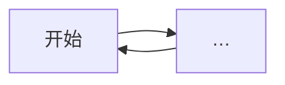

# 顶层设计：<游戏名>

> Top Design 定循环与规模。**不写**具体表内容、UI 像素布局。

## 顶层定位

## 规模锚点

| 项 | 定义 |
|---|---|
| 循环单位 | （一局 / 一天 / …） |
| 局内时长 | |
| 局外时长 | （若无写「无」） |
| 操作复杂度 | |
| 长期主轴优先级 | |

## 核心循环图

## 资源流图（若有养成/经济）

## 一局 / 一天流程

| 步骤 | 玩家做什么 | 系统反馈 |
|---|---|---|
| 1 |  |  |

## 系统范围表

| 系统 | 顶层目的 | 本阶段边界（不展开） |
|---|---|---|
|  |  |  |

## 不做清单

-

## 验证标准

| 目标 | 成功标准 |
|---|---|
| 玩家能口头复述核心循环 |  |
|  |  |
