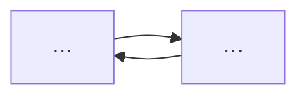
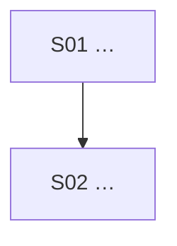

# 系统架构：<游戏名>

> Architecture 定 P0 系统与依赖。**不写**单系统内部规则与具体数值。

## 一句话架构

## 总体闭环

## P0 系统清单

| 系统 | 目的 | 输入 | 输出 | 为何 P0 |
|---|---|---|---|---|
|  |  |  |  |  |

## 系统依赖

## MVP 最小闭环（≤ 7 步）

1.
2.
3.

## 落到框架的标记

| 系统/需求 | 是否需要 | 落点 |
|---|---|---|
| 养成 / 产出 / 价格 | 是/否 | `@mg/economy` TSV |
| 分支对话 | 是/否 | `@mg/story` `.story.tsv` |
| 2D 物理 | 是/否 | `@mg/physics-2d` / `games/platformer` |
| 存档字段 | 是/否 | `createSave`（HANDOFF 说明迁移） |

## P1 / P2 后置

| 内容 | 后置原因 |
|---|---|
|  |  |

## 风险校验

-
